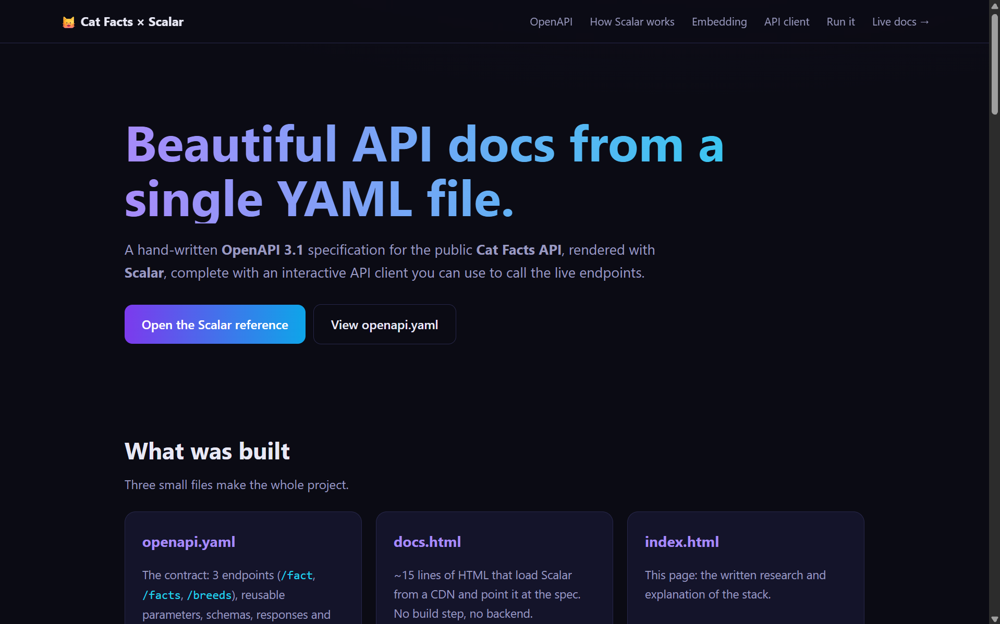

# Cat Facts API documented with Scalar

Problem 11: API Documentation with Scalar (Introduction to Modern Application Development).

A hand-written **OpenAPI 3.1** spec for the public [Cat Facts API](https://catfact.ninja), rendered with **Scalar**, including an interactive API client that calls the live endpoints.

**Live demo:** https://kpr3306-lab.github.io/scalar-cat-facts-docs/ · [Scalar reference](https://kpr3306-lab.github.io/scalar-cat-facts-docs/docs.html)

## Files
- `openapi.yaml`: hand-written OpenAPI 3.1 spec for https://catfact.ninja (`/fact`, `/facts`, `/breeds`)
- `docs.html`: Scalar API reference + built-in API client, loaded from the jsDelivr CDN
- `index.html`: project write-up (OpenAPI structure, how Scalar works, embedding, API client)

## Endpoints
| Method | Path | Purpose | Key params |
|--------|------|---------|------------|
| GET | `/fact` | One random fact | `max_length` |
| GET | `/facts` | Paginated list of facts | `limit`, `page`, `max_length` |
| GET | `/breeds` | Paginated list of breeds | `limit`, `page` |

## Tools
OpenAPI 3.1 · Scalar API Reference · HTML/CSS · jsDelivr CDN · GitHub Pages

## Run locally
    python -m http.server 8000
Open http://localhost:8000 (write-up) and http://localhost:8000/docs.html (Scalar).

Opening the files straight from disk (`file://`) won't work: the browser blocks `docs.html` from fetching `openapi.yaml`.
